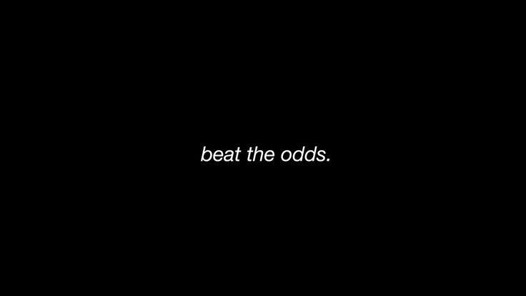

   <!--[cite: 3] -->

 

Data Science & Machine Learning Enthusiast. 3rd-year B.Tech AI & Data Science student at SPPU, passionate about turning raw data into real-world impact. Currently exploring NLP, Computer Vision, and deepening my skills in Python and SQL. Always curious. Always building.

 

  
  
  

<h3 align="center">⎯⎯⎯⎯⎯⎯⎯⎯⎯⎯⎯⎯⎯⎯⎯⎯⎯⎯⎯⎯⎯⎯⎯⎯⎯⎯⎯⎯⎯⎯⎯⎯⎯⎯⎯⎯⎯⎯⎯ ✦ ⎯⎯⎯⎯⎯⎯⎯⎯⎯⎯⎯⎯⎯⎯⎯⎯⎯⎯⎯⎯⎯⎯⎯⎯⎯⎯⎯⎯⎯⎯⎯⎯⎯⎯⎯⎯⎯⎯⎯</h3>

<h3 align="right">Developer at Custodia</h3>

Custodia is a browser-based coding platform we built for our college crew, with an in-browser editor, instant code execution and practice sets for Python, SQL, Java, C, DSA, DBMS and ML. I am currently developing the Multi-Layer Perceptron (MLP) section for the platform. We also actively participate in hackathons like the Smart India Hackathon.

 

<h3 align="center">⎯⎯⎯⎯⎯⎯⎯⎯⎯⎯⎯⎯⎯⎯⎯⎯⎯⎯⎯⎯⎯⎯⎯⎯⎯⎯⎯⎯⎯⎯⎯⎯⎯⎯⎯⎯⎯⎯⎯ ✦ ⎯⎯⎯⎯⎯⎯⎯⎯⎯⎯⎯⎯⎯⎯⎯⎯⎯⎯⎯⎯⎯⎯⎯⎯⎯⎯⎯⎯⎯⎯⎯⎯⎯⎯⎯⎯⎯⎯⎯</h3>

<h3>Motorcyclist, Photographer, Open-Source Contributor</h3>

When I'm not building models, I'm out riding my Triumph Speed 400 ("Boa"), capturing hilltop and landscape photography around Pune, or catching up on IPL cricket. I also actively maintain open-source projects like CrediCheck-AI and Urban-Heat-Mitigation.

 
